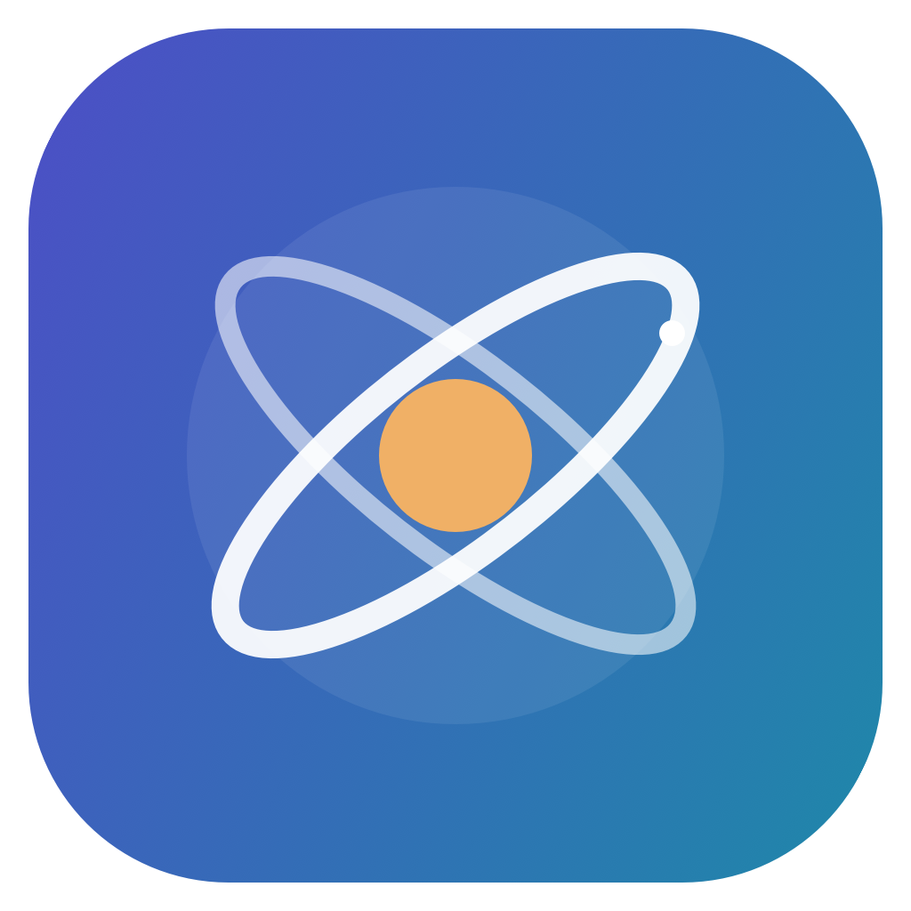

<p align="center">
  
</p>

# Shilgara

**A native macOS academic companion for making course progress easier to understand.**

Shilgara brings courses, assessments, exam dates, and academic history into one focused SwiftUI workspace. It was shaped around a real student's workflow: grading rules vary by course, some marks arrive before their syllabus weights are clear, and a useful forecast must distinguish confirmed results from assumptions.

## What it does

- **Academic overview:** See current courses, progress, and the next useful actions at a glance.
- **Courses and grades:** Record assessments, actual marks, and optional predictions. Calculate weighted progress using direct assessment weights or syllabus categories, including configurable dropped results.
- **Academic journey:** Review completed courses and credit-weighted results. Where published course averages are available, compare them with the same set of completed courses and clearly identify the source.
- **Exam schedule:** Keep quizzes, midterms, and finals with dates or a TBA state.
- **Local data:** Save records on the Mac, with JSON backup and restore. The app refuses to overwrite an existing unreadable data file.

The interface uses a custom orbit symbol, a restrained color system, responsive window layouts, and a short opening animation. See [DESIGN.md](DESIGN.md) for the visual direction.

## Run locally

Requires macOS 14 or later and Xcode with its command line tools. Open `Package.swift` in Xcode, or build the standalone app:

```sh
zsh scripts/build-app.sh
open dist/Shilgara.app
```

Run the calculation and persistence checks with `zsh scripts/test-grade-engine.sh`.

On a new Mac, the app starts with empty records. This repository contains **no personal courses, grades, Canvas exports, or Workday records**. Data entered in the app is stored under `~/Library/Application Support/MacStudy/` and can be exported from the app as a backup. Do not commit exported backups or an `imports/` directory.

## Design and implementation

The app separates Codable academic records (`Models.swift`), deterministic grade calculations (`GradeEngine.swift`), local persistence (`AcademicStore.swift`), and SwiftUI presentation. Confirmed marks, forecasts, and unknown future work are represented separately so missing information does not appear as a final grade. Category calculations depend on the assessment plan entered for each course; forecasts should be interpreted only after its syllabus rules and expected assessments are complete.

The project was developed collaboratively with **OpenAI Codex**. I directed the product requirements and visual direction, checked course and grading workflows against real academic use, and iterated on the interface and calculations; Codex assisted with implementation and testing. The public repository uses synthetic test cases and excludes personal academic records.

## Current scope

This is an early, usable macOS version. Course and assessment data is entered or imported manually through local backups. It does not automatically sync with Workday, Canvas, or UBCGrades. Published course averages can be stored with source details when available.
